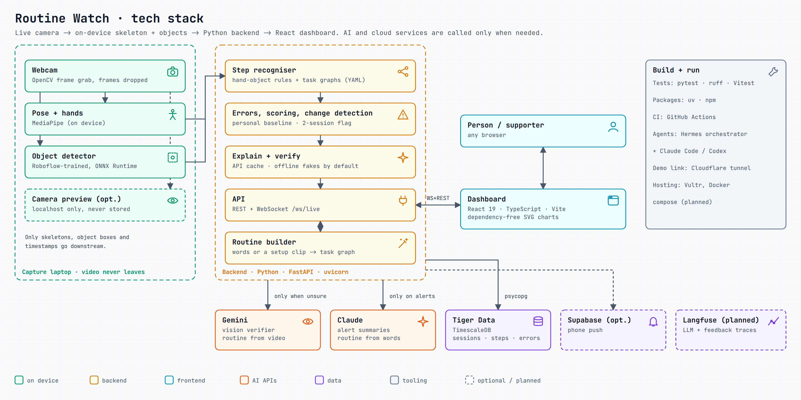

# Routine Watch

**Hack the Valley 11.** A privacy-first camera that watches an everyday routine, like making a cup of tea, and **flags a change for review** when someone's routine starts going differently from their own usual. Every flag shows its evidence. It never diagnoses.

It's for anyone who wants that support: **a person watching their own routine**, or **a supporter** (family, a carer, a nurse) looking out for someone.



## What it does

- **Watches a routine live:** pose and hand landmarks (MediaPipe) plus a locally trained object detector turn the camera into step events: kettle filled, teabag in, poured. Frames are dropped on the device.
- **Spots errors:** skipped steps, wrong order, repeats, wrong object, hesitation and abandonment, checked against a task graph (dependencies, not a fixed order).
- **Learns the person's normal:** a personal baseline. A change is flagged only after **two unusual sessions within 48 h**; one bad day never alerts.
- **Explains every flag:** the exact errors with timestamps, a skeleton-only replay, the baseline comparison, the patterns the change is *consistent with* (and what to rule out), and suggested checks. Claude writes the summary from that evidence only.
- **Two roles:** "My routine" for the person, and "People I support" for supporters, with a replays library, a pattern library and confirm / false-alarm feedback that tunes the threshold per person.
- **Safety check-ins (Project KAZE):** when an alert fires, the person is asked to check in. If they don't, their supporter gets an alarm, then the next supporter. There's a safety PIN, a silent duress PIN, a server-side countdown that survives a disconnect, and per-supporter sharing permissions. See `docs/KAZE.md`.
- **Routine builder:** describe a new routine in words, or upload one setup clip (Gemini, opt-in, never stored), and get an editable task graph.

**Impact (synthetic data, see `docs/EVAL.md`):** on a seeded cohort of 50 people over 60 days, sudden changes were flagged a median **18.5 h after onset**, about **40 h earlier than a weekly check**. The cohort is synthetic, so real-world numbers will be worse; the doc states the limits and what a pilot would measure.

## Run it

```bash
gh repo clone IanLeung12/htv-2026 && cd htv-2026
cp .env.example .env            # defaults are offline: no keys, no cost
scripts/dev.sh up               # API :8000 + dashboard :5173 (DASHBOARD_MODE=preview for a built, faster UI)
scripts/dev.sh down
```

Open `http://localhost:5173` and choose **for myself** or **supporting someone**.

- **Live camera:** `scripts/camera.sh --preview` installs MediaPipe/OpenCV, downloads the models, checks the camera and opens the Live screen. `--preview` adds the real video under the skeleton, served on this device only. Run it natively on the machine with the webcam; WSL can't see webcams.
- **Object detection:** export a YOLO model to `models/detector.onnx` and set `DETECTOR_WEIGHTS=models/detector.onnx`. Without it you get the skeleton, hands and recorded sessions, but no live tea steps. Train locally from a Roboflow-labelled dataset; never use Roboflow's hosted inference. See `docs/DEMO.md`.
- **Other devices on the same Wi-Fi:** `LAN=1 scripts/dev.sh up` (or `LAN=1 scripts/camera.sh`) prints a URL for a phone or second laptop. The camera preview never leaves the capture machine.
- **KAZE scenarios:** `python3 scripts/kaze_demo.py no-response` (or `safe`, `duress`, `disconnect`, `unacknowledged`, `false-alarm`, `privacy`, `all`).
- **Real AI calls:** put your keys in `.env` and set `LIVE_API=1`. Responses are cached on disk. Run `python3 scripts/env_sync.py` to pick up new settings without losing your values.

## Test it

```bash
scripts/ci.sh             # everything: tooling, ruff + pytest, web lint/test/build/bundle budget, e2e
scripts/ci.sh --changed   # only the parts your branch touches (fast local check)
scripts/e2e.sh            # replay every recorded scenario through the pipeline, offline
python3 scripts/eval.py   # the impact evaluation above
```

GitHub CI runs `scripts/ci.sh` as four parallel jobs on every PR and on `main`.

## Privacy and responsible design

- Skeletons, object boxes and timestamps only. No raw video is stored, there's no face identification, and evidence is shown as skeleton replays.
- It flags a change for a human to review and never diagnoses; that wording is kept consistent everywhere. The AI summary may only restate detected evidence.
- Uncertainty is shown: low-confidence moments are marked **unclear** and never counted as errors. Pose estimation is less accurate with walkers or wheelchairs, and we say so.
- Opt-in per person and per room, and it can be turned off. Supporters only see what the person has allowed.

## Where things are

```
pipeline/   Python 3.11 (uv): capture, recogniser, task graphs (tasks/*.yaml), errors, baseline,
            change detection, patterns, check-ins, routine builder, FastAPI + WebSocket API
web/        Vite + React 19 + TypeScript dashboard (both roles), dependency-free SVG charts
scripts/    dev.sh, camera.sh, ci.sh, e2e.sh, eval.py, kaze_demo.py, env_sync.py, tasks.py, worker.sh
tests/      recorded scenarios and repo-tooling tests
docs/       DEMO, KAZE, EVAL, DESIGN, DEPLOY, CODEMAP (module map), diagrams
```

Full spec: `SPEC.md`. Agent rules: `AGENTS.md`.

## How it was built

A team of AI coding agents, coordinated by **Hermes**, built most of this, with humans setting direction, design and the demo.

- **The board:** `TASKS.md` lives on the `tasks` branch, and `scripts/tasks.py` claims tasks atomically through git.
- **Workers:** Claude Code and Codex, on the VPS and teammates' machines, each claim a task, open a PR, and the merge queue (`scripts/mergeq.py`) merges it when CI is green.
- **Scheduled jobs:** an orchestrator plans tasks and keeps `main` green; a tester replays scenarios and walks the UI in a browser; a reviewer files bugs; an integration check runs hourly.
- See the orchestration diagram in `docs/orchestration.png`.

To run a worker:

```bash
AGENT=yourname CLASS=standard scripts/worker.sh   # CLASS: light | standard | heavy; TOOL=codex for Codex
```
