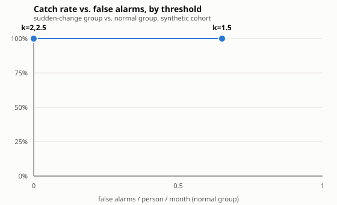

# Impact evaluation (synthetic data)

Measured on a seeded synthetic cohort, not real residents: 50 people x
60 days (15 sudden-change, 8 slow-drift, 27
normal-with-noise), generated by `scripts/eval.py` and printed by running it. Same
arguments always print the same numbers (`python3 scripts/eval.py --write-docs`
regenerates this file).

## Method

For each synthetic person: build their own baseline from their earliest
14 days of sessions, then flag changes the same way the live
pipeline does (`routine_watch.change_detection.flag_change`: two or more sessions
above baseline within 48 h). The sudden-change group gets a known, seeded onset day;
the drift group uses the existing slow-drift generator unmodified; the normal group
is noise only, used to measure false alarms. A weekly-screening baseline is simulated
by checking only the most recent session every 7 days. All of this is offline,
deterministic (seeded), and uses no paid API calls.

## Headline numbers

| Metric | Value |
|---|---|
| Sudden changes caught | 15 / 15 (100%) |
| Sudden changes missed | 0 |
| Hours from onset to flag (median) | 18.5 h |
| Hours from onset to flag (p90) | 32.3 h |
| False alarms, normal group | 0.00 / person / month |
| Hours earlier than weekly check, median | 39.6 h |
| Hours earlier than weekly check, p90 | 98.2 h |
| (matched cases: caught by both ours and weekly) | n=15 |
| Slow drift reported as a trend, not an alarm | 5 / 8 |

## Sensitivity sweep

Three threshold settings (`k`, standard deviations above this resident's own mean),
showing the catch-rate vs. false-alarm trade-off:

| k | catch rate | false alarms / person / month |
|---|---|---|
| 1.5 | 100% | 0.7 |
| 2 | 100% | 0.0 |
| 2.5 | 100% | 0.0 |

Catch rate does not move across this sweep because the synthetic sudden-change
profile is intentionally large relative to this resident's own noise (SPEC's
two-sessions-in-48h rule only needs one elevated score on each side of it); the axis
that actually trades off here is false alarms. That is itself a finding: on this
synthetic cohort, `k=2.0` already catches everything at zero false-alarm cost, and
`k=1.5` buys nothing but more false alarms.

## Limits, stated plainly

- **Synthetic data.** These numbers come from a generator with hand-set error rates
  (`pipeline/src/routine_watch/synth`), not from real residents or a clinical trial.
  They show the *pipeline's own logic* is internally consistent (it catches the
  changes it was told to make, at the rate its threshold implies) - not that real
  everyday-action errors look exactly like this.
- **Error rates and the two-sessions-in-48h rule are from the literature** cited in
  `SPEC.md` §7 (neuropsychology everyday-action-error studies, the HelpMeOut
  benchmark), not from clinical validation of this product.
- **No real pilot yet.** A real pilot would measure: how often a nurse's "what was
  it?" feedback agrees with the pattern the flag suggested; time from flag to a nurse
  actually looking at the alert (not just time to flag); and whether flagging changes
  clinical outcomes at all, against a control unit using the current weekly-screening
  routine.

## Impact estimate

**If 1 in 10 flagged sudden changes leads to an intervention (a med review, a UTI
caught early) that would otherwise have waited for the next weekly check, and 1 in 5
of those avoids an ER visit or hospital stay**, then for every ~50 sudden changes this
catches, roughly 1 ER visit is avoided. This is a rough, assumption-driven estimate
for pitching the idea, not a clinical claim: the "1 in 10" and "1 in 5" figures are
illustrative, not measured, and a real pilot (above) is what would measure them.
